```{r setup, include=FALSE, warning=FALSE, results = 'asis', echo=FALSE}
cores<-c("#c2a5cf","#BAF3DE","#C9E69E","#FF9B95","#FFC29A")
suppressMessages(library("dplyr"))
suppressMessages(library("gamlss"))
suppressMessages(source("estimacao.R"))
suppressMessages(library("doParallel"))
suppressMessages(library("knitr"))
suppressMessages(library("kableExtra"))
suppressMessages(source("funcoes.R"))
# Draw of the model to be worked on
set.seed(123)
modelos<-c(1:10)
sample(modelos,size=1)

```
\newpage

## Introduction

This work aims to evaluate the performance of the MDPDE in comparison to the MLE under different contamination scenarios and tuning constant values $\alpha \in [0,1)$. We drew a number from 1 to 10 in R Core Team (2026) to define the model to be worked on. Model number 3 was drawn, therefore, we will work with the Gamma regression model. In the following sections, we will define the model, present the adopted methodologies, describe the scenarios, and discuss the  results. 

## Model and Methodologies
Let $Y$ be a random variable with a Gamma distribution with mean $\mu$ and coefficient of variation $\phi^{-\frac{1}{2}}$. The probability density function of $Y$ is given by:

\begin{align*}
f_Y(y,\mu,\phi) = exp\left\{ \phi \left[ \frac{-y}{\mu} - log(\mu) \right] - log(\Gamma(\phi)) + \phi log(\phi y) - log(y) \right\},
\end{align*} 

where $y>0$, $\phi>0$, $\mu>0$, and $\Gamma(\phi) = \int_0^\infty t ^{\phi -1} e^{-t}dt$ is the gamma function.Let $Y_1, \cdots, Y_n$ be a random sample with

\begin{align*}
Y_i|\mathbf{x_i} \overset{\text{ind}}{\sim} Gamma (\mu_i, \phi) \\
\eta_i = log(\mu_i), \eta_i = \mathbf{x_i}^{\intercal} \boldsymbol{\beta}
\end{align*}

In this work, we will keep $\phi$ fixed, thus, the parameter vector is $\boldsymbol{\beta} = (\beta_0, \beta_1)^\intercal$. The score vector can be obtained by differentiating the log-likelihood with respect to $\boldsymbol{\beta}$. For the i-th observation, it is given by:

\begin{align*}
u_{\boldsymbol{\beta}}(y_i) = \phi \frac{(y_i - \mu_i)}{\mu_i} \mathbf{x_i},
\end{align*}

where $\mathbf{x_i}$ is the i-th row of matrix $\mathbf{X}$. For the full sample, it can be expressed as

\begin{align*}
U_{\boldsymbol{\beta}}(\boldsymbol{y}) = \phi \mathbf{X}^\intercal \mathbf{V}^{\frac{-1}{2}}(\mathbf{y}- \mathbf{X}\boldsymbol{\beta})
\end{align*}

where $\mathbf{V}^{-\frac{1}{2}} =\text{diag}\left\{ \frac{1}{\mu_1}, \cdots, \frac{1}{\mu_n}  \right\}$, since the variance function for the Gamma distribution is $V(\mu) = \mu^2$.

### Maximum Likelihood Estimator (MLE)

The maximum likelihood estimates for $\boldsymbol{\beta}$ will be obtained using the *gamlss* package (Rigby and Stasinopoulos, 2005).


### Minimum Density Power Divergence Estimator (MDPDE)
To obtain the MDPDE estimates, we constructed an estimation algorithm.
The MDPDE minimizes the following loss function:

\begin{align*}
H_n(\boldsymbol{\beta}) =  \int_{\mathcal{X}} f_Y^{1+\alpha}(z; \mu_i, \phi)dz -  \left( 1 + \frac{1}{\alpha} \right) \frac{1}{n} \sum_{i=1}^n f_Y^\alpha(Y_i; \mu_i, \phi) , \text{ for } \alpha \in [0,1).  
\end{align*}

As $\alpha\rightarrow0$ 0, the MDPDE reduces to the MLE. The MDPDE belongs to the class of M-estimators. It satisfies estimating equations defined by the score-weighted $\psi$-function:

\begin{align*}
\psi(y_i,\beta) = u_{\beta}(y_i) f_Y^{\alpha}(y_i;\mu_i, \phi)-\int_{\mathcal{X}}  u_{\beta}(z) f_Y^{1+\alpha}(z;\mu, \phi)(z)dz
\end{align*}

And the estimates are obtained by solving the system of estimating equations:$$\sum_{i=1}^n \psi_i(y_i, \beta) = \mathbf{0}$$

### Estimation Algorithm: Iteratively Reweighted Least Squares (IRLS / Fisher Scoring) for MDPDE

Following the classical Generalized Linear Model (GLM) framework and directly reflecting our R implementation, the iterative procedure for obtaining the Minimum Density Power Divergence Estimator (MDPDE) in Gamma regression is structured as follows:

#### Step 1: Initialization ($m = 0$)
The initial parameter vector $\boldsymbol{\beta}^{(0)}$ is initialized with the Maximum Likelihood Estimates (MLE) fitted via the `gamlss` package:
$$\boldsymbol{\beta}^{(0)} = \hat{\boldsymbol{\beta}}_{\text{MLE}}$$

#### Step 2: Updating Quantities at Iteration $m$
Given the current parameter estimates $\boldsymbol{\beta}^{(m)}$ at iteration $m$:

1. **Linear Predictor and Mean Vector ($\boldsymbol{\mu}$):**
   $$\boldsymbol{\eta}^{(m)} = \mathbf{X} \boldsymbol{\beta}^{(m)}, \quad \mu_i^{(m)} = \exp\left(\eta_i^{(m)}\right), \quad i = 1, \dots, n$$

2. **Robust Weight Matrix ($\mathbf{W}$):**
   Calculate the density power weights $w_i^{(m)}$ for each observation using the Gamma probability density function $f_Y(y_i; \mu_i^{(m)}, \phi)$:
   $$w_i^{(m)} = \left[ f_Y(y_i; \mu_i^{(m)}, \phi) \right]^\alpha, \quad \mathbf{W}^{(m)} = \text{diag}\left\{ w_1^{(m)}, \dots, w_n^{(m)} \right\}$$

3. **Adjusted Response Vector ($\mathbf{z}_{\text{adj}}$):**
   Form the working response vector based on the log-link GLM linearization:
   $$\mathbf{z}_{\text{adj}}^{(m)} = \boldsymbol{\eta}^{(m)} + \frac{\mathbf{y} - \boldsymbol{\mu}^{(m)}}{\boldsymbol{\mu}^{(m)}}$$

4. **Integral Bias Correction Term ($\boldsymbol{b}_{\text{soma}}$):**
   Evaluate the integral penalty vector $\boldsymbol{b}_{\text{soma}}^{(m)}$ required for the MDPDE score equations.

#### Step 3: Matrix Computations and Parameter Update
Compute the weighted Hessian matrix and the working response projection vector:
$$\mathbf{H}^{(m)} = \phi \mathbf{X}^\top \mathbf{W}^{(m)} \mathbf{X}$$
$$\mathbf{V}_z^{(m)} = \phi \mathbf{X}^\top \mathbf{W}^{(m)} \mathbf{z}_{\text{adj}}^{(m)}$$

The parameter update at step $m+1$ is obtained by solving the linear system:
$$\boldsymbol{\beta}^{(m+1)} = \left( \mathbf{H}^{(m)} \right)^{-1} \left( \mathbf{V}_z^{(m)} - \boldsymbol{b}_{\text{soma}}^{(m)} \right)$$

##### Closed-Form Solution of the Integral Bias Vector ($\boldsymbol{b}_{\text{soma}}$)

To ensure Fisher consistency for the MDPDE when $\alpha > 0$, the integral bias correction term is computed analytically:

$$\boldsymbol{b}_{\text{soma}} = \mathbf{X}^\top \boldsymbol{v}_b$$

where $\boldsymbol{v}_b = (b_{1,\text{scalar}}, \dots, b_{n,\text{scalar}})^\top$ is an $n \times 1$ vector whose elements are defined as:

$$b_{i,\text{scalar}} = \frac{\phi^{1 - \phi \alpha} \cdot \alpha \cdot \Gamma\big( (1+\alpha)\phi - \alpha \big)}{\mu_i^\alpha \cdot (1+\alpha)^{(1+\alpha)\phi + 1} \cdot \Gamma^{1+\alpha}(\phi)}$$


#### Step 4: Convergence Check
Compute the sum of squared differences between successive parameter vectors:
$$\text{criterio} = \sum_{j=0}^p \left( \beta_j^{(m+1)} - \beta_j^{(m)} \right)^2$$

* **If $\text{criterio} < \delta$:** The algorithm stops and returns the converged estimates $\hat{\boldsymbol{\beta}}_{\text{MDPDE}} = \boldsymbol{\beta}^{(m+1)}$.
* **Otherwise:** Set $\boldsymbol{\beta}^{(m)} \leftarrow \boldsymbol{\beta}^{(m+1)}$ and return to **Step 2**.

\newpage

## Simuation Study

The true model, that is, the one that will generate the samples, is defined as follows:

\begin{align*}
Y_i|\mathbf{x_i} \overset{\text{ind}}{\sim} Gamma (\mu_i, \phi) \\
\eta_i = log(\mu_i), \eta_i = \beta_0 + \beta_1 x_{i1}
\end{align*}

where $$\boldsymbol{\beta} = (0.3, 0.1)^\intercal;\ \phi=4;\ x_{i1} \sim U(1,10);\ i=1,\cdots,n. $$

```{r, echo=FALSE}
M<-3000
tam.n<-c(50,200,1000)
beta.verd<-c(0.3,0.1)
phi<- 4  # phi = 1/sigma2
sigma<-1/sqrt(phi)
```


### Scenario C0 (No contamination):

Pure data generated strictly by the theoretical model.


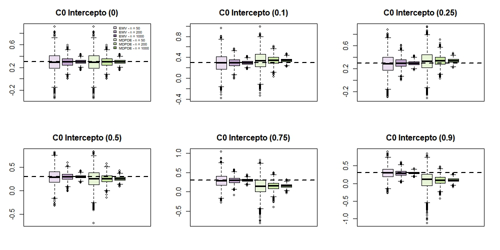


In Figure 1, six distributions are displayed in the same plot. The first three correspond to the Maximum Likelihood Estimator (MLE) for sample sizes $n = \{50, 200, 1000\}$, while the remaining three correspond to the Minimum Density Power Divergence Estimator (MDPDE). The values of the tuning parameter $\alpha \in \{0, 0.1, 0.25, 0.5, 0.75, 0.9\}$ are given in parentheses. As expected, for $\alpha = 0$, the MLE and MDPDE share the exact same distribution for the estimates. However, as $\alpha$ approaches 1, the MLE exhibits superior performance, whereas the MDPDE displays bias.


```{r, echo=FALSE}
alfas<-c(0,0.1,0.25,0.5,0.75,0.9)
nome.amostra<-"C0"

# Gera a tabela completa unificada:
calcula_desempenho_completo.intercepto(
  alfas = alfas, 
  tam.n = tam.n, 
  valor_real = beta.verd[1],
  nome.amostra
)

```
In Table 1, we observe that the MLE presents better results in terms of MSE. For $\alpha > 0$, the MLE becomes more competitive, as the MDPDE is known to suffer from a loss of efficiency.

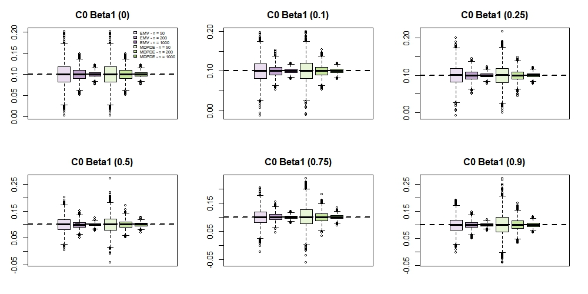
```{r, echo=FALSE}
calcula_desempenho_completo.beta1(
  alfas = alfas, 
  tam.n = tam.n, 
  valor_real = beta.verd[2],
  nome.amostra
)
```
For $\beta_1$, Figure 2 and Table 2 show that the MLE achieves superior performance.

In the scenario without contamination (pure data), the MDPDE suffers in the trade-off against the Maximum Likelihood Estimator (MLE). Because the data strictly follow the assumed model, the MLE is the most efficient estimator, yielding lower MSE values.


### Scenario C1 (5% of contamination):
In this scenario, 5% of the observations had their response values replaced by a value generated from a Gamma distribution with a mean 5 times the original mean value of the observation

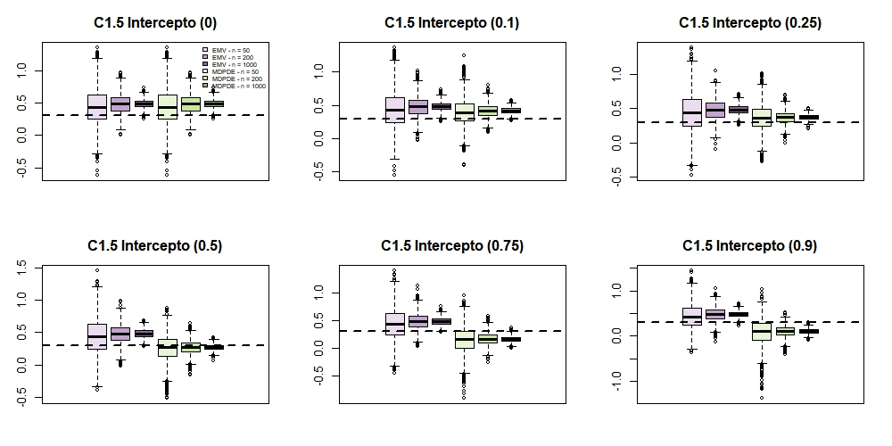


In Figure 3, six distributions are displayed in the same plot. The first three correspond to the Maximum Likelihood Estimator (MLE) for sample sizes $n = \{50, 200, 1000\}$, while the remaining three correspond to the Minimum Density Power Divergence Estimator (MDPDE). The values of the tuning parameter $\alpha \in \{0, 0.1, 0.25, 0.5, 0.75, 0.9\}$ are given in parentheses. As expected, for $\alpha = 0$, the MLE and MDPDE share the exact same distribution for the estimates. For $\alpha = 0.5$ MDPDE appear to have superior performance.


```{r, echo=FALSE}
alfas<-c(0,0.1,0.25,0.5,0.75,0.9)
nome.amostra<-"C1.5"

# Gera a tabela completa unificada:
calcula_desempenho_completo.intercepto(
  alfas = alfas,
  tam.n = tam.n,
  valor_real = beta.verd[1],
  nome.amostra
)

```
In Table 3, we observe that for $\alpha \in [0.1, 0.75]$, the MDPDE achieves a lower MSE. Consequently, it is preferred under sample contamination. For higher tuning parameters, such as $\alpha = 0.9$, the variance-bias trade-off favors the MLE.


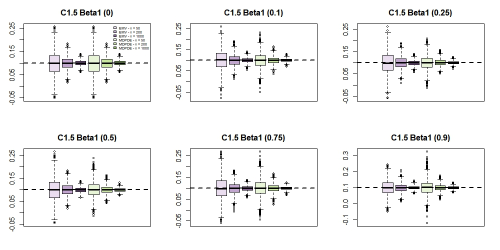
```{r, echo=FALSE}
calcula_desempenho_completo.beta1(
  alfas = alfas, 
  tam.n = tam.n, 
  valor_real = beta.verd[2],
  nome.amostra
)
```
For $\beta_1$, Figure 4 presents no indication that the MDPDE is preferred. However, Table 4 demonstrates that the MDPDE achieves superior performance. In the scenario with 5% contamination, the trade-off favors the Maximum Likelihood Estimator (MLE) over the MDPDE, as the light contamination level is insufficient to offset the efficiency loss associated with robust estimation.


### Scenario C1 (10% of contamination):
In this scenario, 10% of the observations had their response values replaced by a value generated from a Gamma distribution with a mean 5 times the original mean value of the observation

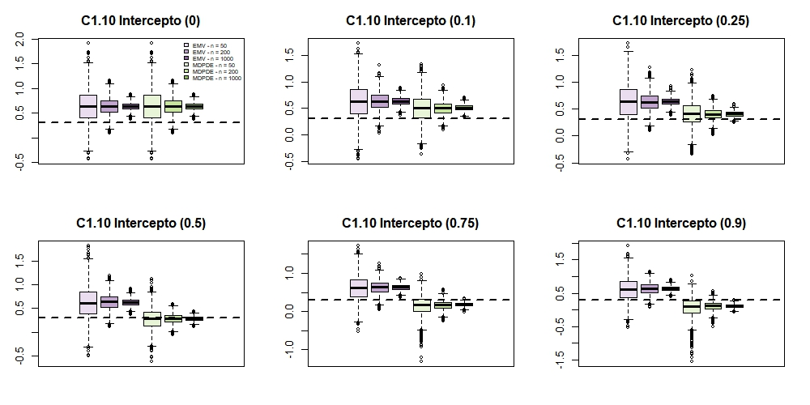


In Figure 5, six distributions are displayed in the same plot. The first three correspond to the Maximum Likelihood Estimator (MLE) for sample sizes $n = \{50, 200, 1000\}$, while the remaining three correspond to the Minimum Density Power Divergence Estimator (MDPDE). The values of the tuning parameter $\alpha \in \{0, 0.1, 0.25, 0.5, 0.75, 0.9\}$ are given in parentheses. As expected, for $\alpha = 0$, the MLE and MDPDE share the exact same distribution for the estimates. However, as $\alpha$ approaches 0.5, the MDPDE appear to have superior performance, whereas the MLE displays bias.


```{r, echo=FALSE}
alfas<-c(0,0.1,0.25,0.5,0.75,0.9)
nome.amostra<-"C1.10"

# Gera a tabela completa unificada:
calcula_desempenho_completo.intercepto(
  alfas = alfas, 
  tam.n = tam.n, 
  valor_real = beta.verd[1],
  nome.amostra
)


```
In Table 5, we observe that the MDPDE is preferred under sample contamination, achieving the lowest MSE at $\alpha = 0.5$.

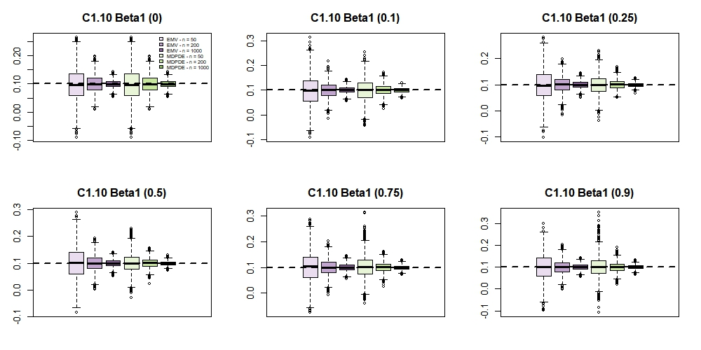
```{r, echo=FALSE}
calcula_desempenho_completo.beta1(
  alfas = alfas, 
  tam.n = tam.n, 
  valor_real = beta.verd[2],
  nome.amostra
)
```
For $\beta_1$, Figure 6 shows no clear preference for the MDPDE. However, Table 6 demonstrates that the MLE achieves superior performance.

In the scenario with 10% contamination, the trade-off strongly favors the MDPDE over the MLE, as the contamination degrades the performance of the Maximum Likelihood Estimator.

### Scenario C2 (5% of contamination):
In this scenario, 5% of the observations had their respective values for the covariate $x_{i1}$ generated from a continuous uniform distribution on the interval $(16, 17)$.

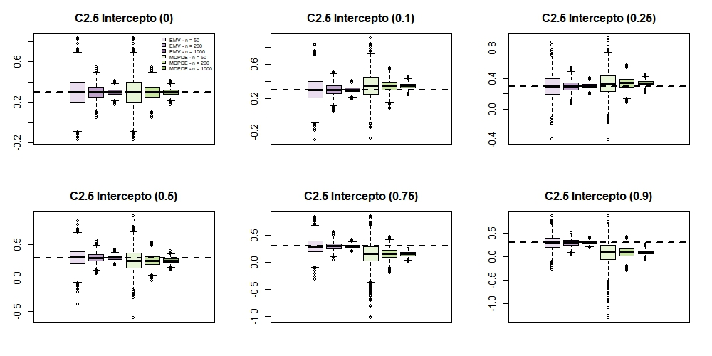


As expected, for $\alpha = 0$, the MLE and MDPDE share the exact same distribution for the estimates. However, as $\alpha$ approaches 1, the MLE appear to have superior performance, whereas the MDPDE displays bias.


```{r, echo=FALSE}
alfas<-c(0,0.1,0.25,0.5,0.75,0.9)
nome.amostra<-"C2.5"

# Gera a tabela completa unificada:
calcula_desempenho_completo.intercepto(
  alfas = alfas, 
  tam.n = tam.n, 
  valor_real = beta.verd[1],
  nome.amostra
)


```
In Table 7, we observe that MLE presents an better peformance for estimating the intercept in this contamination cenario.

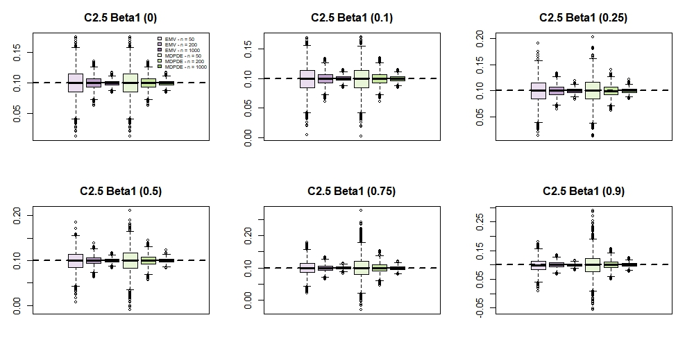
```{r, echo=FALSE}
calcula_desempenho_completo.beta1(
  alfas = alfas, 
  tam.n = tam.n, 
  valor_real = beta.verd[2],
  nome.amostra
)
```
For $\beta_1$, Figure 8 and Table 7  show that the MLE achieves superior performance.

In the scenario with 5% contamination, the MDPDE suffers in the trade-off against the Maximum Likelihood Estimator (MLE). The contamination was not severe enough to justify using a robust technique. Thus, the MLE remains the most efficient estimator, achieving minimum variance.


### Scenario C2 (10% of contamination):
In this scenario, 10% of the observations had their respective values for the covariate $x_{i1}$ generated from a continuous uniform distribution on the interval $(16, 17)$.

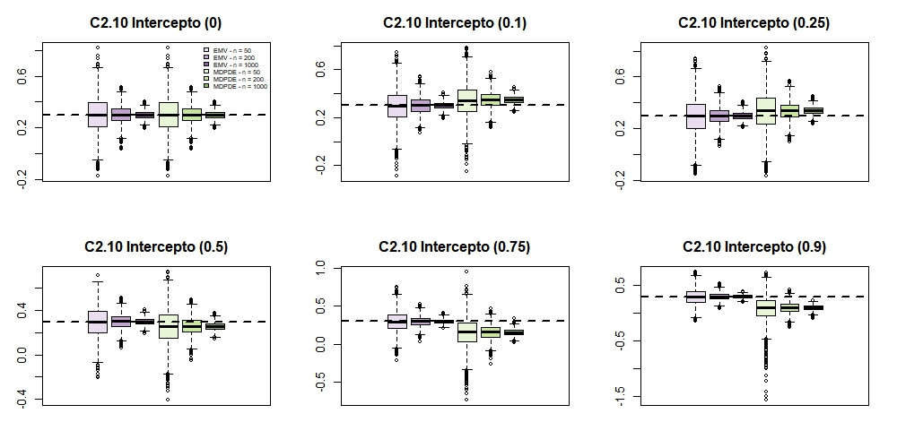

As expected, for $\alpha = 0$, the MLE and MDPDE share the exact same distribution of estimates. However, as $\alpha$ approaches 1, the MLE appears to achieve superior performance, whereas the MDPDE exhibits bias and greater dispersion.


```{r, echo=FALSE}
alfas<-c(0,0.1,0.25,0.5,0.75,0.9)
nome.amostra<-"C2.10"

# Gera a tabela completa unificada:
calcula_desempenho_completo.intercepto(
  alfas = alfas, 
  tam.n = tam.n, 
  valor_real = beta.verd[1],
  nome.amostra
)

```
In Table 9, we observe that the MLE achieves a lower MSE. 

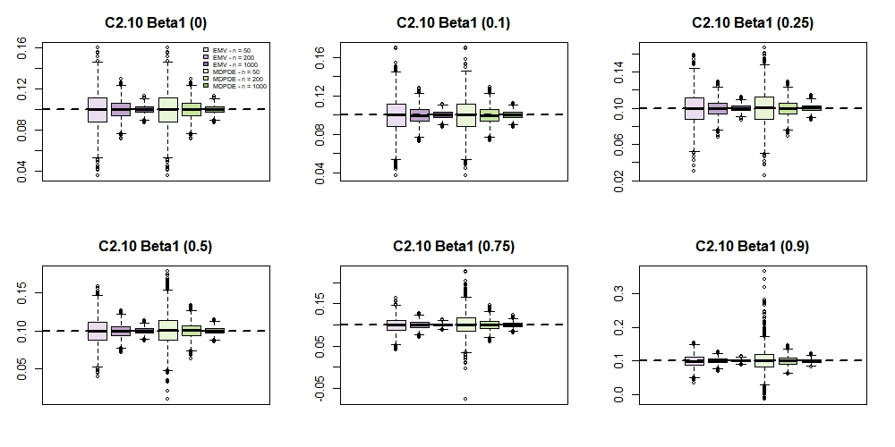
```{r, echo=FALSE}
calcula_desempenho_completo.beta1(
  alfas = alfas, 
  tam.n = tam.n, 
  valor_real = beta.verd[2],
  nome.amostra
)
```
In Figure 10 and Table 10, we observe that the MLE achieves a lower or equivalent MSE. Consequently, it is preferred under the specific contamination pattern present in this scenario.

Even with 10% contamination, the MDPDE suffers in the trade-off against the Maximum Likelihood Estimator (MLE). For this type of contamination, the impact was not severe enough to justify a robust approach. Thus, the MLE remains the most suitable choice by preserving higher efficiency and lower variance.

### Scenario C3 (5% of contamination):
In this scenario, 5% of the observations simultaneously had their responses replaced by a value generated from a Gamma distribution with a mean 5 times the original value, and their respective values for the covariate $x_{i1}$ generated from a continuous uniform distribution on the interval $(16, 17)$.

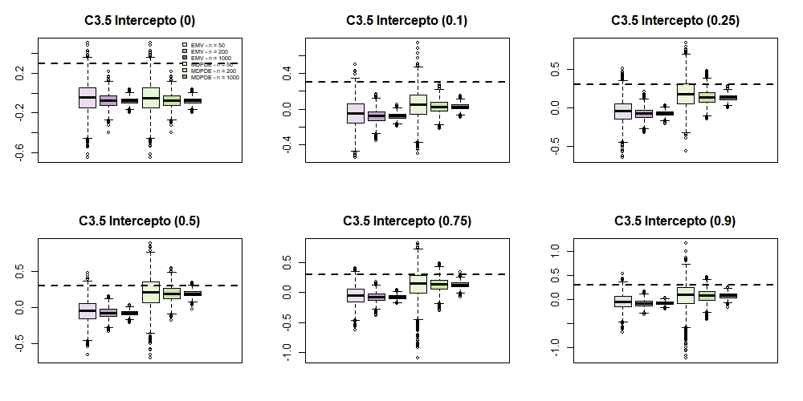


As expected, for $\alpha = 0$, the MLE and MDPDE share the exact same distribution for the estimates. For $\alpha=0.5$ the MDPDE appear to have superior performance.


```{r, echo=FALSE}
alfas<-c(0,0.1,0.25,0.5,0.75,0.9)
nome.amostra<-"C3.5"

# Gera a tabela completa unificada:
calcula_desempenho_completo.intercepto(
  alfas = alfas, 
  tam.n = tam.n, 
  valor_real = beta.verd[1],
  nome.amostra
)


```
In Table 11, we confirm that for larger sample sizes, the MDPDE achieves better performance in terms of MSE at $\alpha = 0.5$.

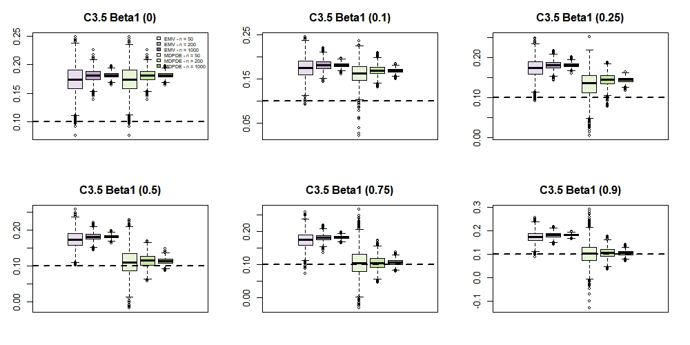
```{r, echo=FALSE}
calcula_desempenho_completo.beta1(
  alfas = alfas, 
  tam.n = tam.n, 
  valor_real = beta.verd[2],
  nome.amostra
)
```
For $\beta_1$, Figure 12 and Table 12 demonstrates that the MDPDE achieves superior overall performance.

In this 5% contamination scenario, the application of a robust method is well justified, as the MLE suffers in the trade-off against the MDPDE.

### Scenario C3 (10% of contamination):
In this scenario, 10% of the observations simultaneously had their responses replaced by a value generated from a Gamma distribution with a mean 5 times the original value, and their respective values for the covariate $x_{i1}$ generated from a continuous uniform distribution on the interval $(16, 17)$.

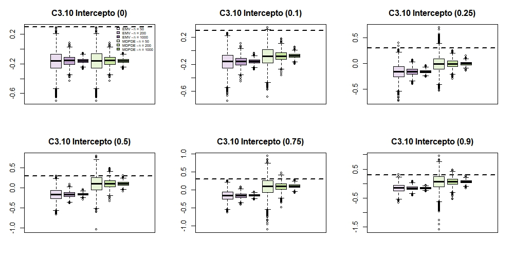


As expected, for $\alpha = 0$, the MLE and MDPDE share the exact same distribution of estimates. However, for $\alpha$ around 0.5, the robust method appears to perform better.


```{r, echo=FALSE}
alfas<-c(0,0.1,0.25,0.5,0.75,0.9)
nome.amostra<-"C3.10"

# Gera a tabela completa unificada:
calcula_desempenho_completo.intercepto(
  alfas = alfas, 
  tam.n = tam.n, 
  valor_real = beta.verd[1],
  nome.amostra
)


```
In Table 13, we observe that the MDPDE is consistently better than the MLE in terms of MSE.

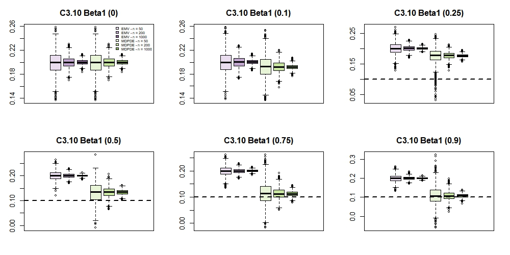
```{r, echo=FALSE}
calcula_desempenho_completo.beta1(
  alfas = alfas, 
  tam.n = tam.n, 
  valor_real = beta.verd[2],
  nome.amostra
)
```
For $\beta_1$, Figure 14 and Table 14 show that the MDPDE achieves superior performance.

In the 10% contamination scenario, the MLE suffers even more in the trade-off against the MDPDE, exhibiting larger MSE values for both parameters compared to the 5% contamination case (Tables 11 and 12). These results further justify the application of robust estimation techniques.

## Conclusion
Overall, the comparative evaluation of the MLE and MDPDE highlights the crucial role of the tuning parameter $\alpha$ and the level of contamination. In the absence of contamination, both estimators coincide at $\alpha = 0$, with the MLE offering optimal efficiency. However, as contamination increases from 5% to 10%, the MLE suffers significant degradation in terms of MSE and dispersion for both the intercept and $\beta_1$. Conversely, setting $\alpha > 0$ (notably around 0.5 to 0.75) allows the MDPDE to maintain robust performance, achieving a lower MSE in larger samples and confirming that robust estimation is essential when data are subject to the types of contamination considered here.

## References

PAULA, Gilberto A. Generalized Linear Models: with applications (in Portuguese). São Paulo: Institute of Mathematics and Statistics, University of São Paulo (IME-USP), 2004. Available at: https://www.ime.usp.br/~giapaula/texto_2026.pdf. Accessed on: 27 Oct. 2026.

QUEIROZ, Francisco Felipe de. Robust Inference. Lecture notes, Institute of Mathematics and Statistics, University of São Paulo (IME-USP), 2026.

RIGBY, Robert A.; STASINOPOULOS, D. Mikis. Generalized additive models for location, scale and shape (with discussion). Journal of the Royal Statistical Society: Series C (Applied Statistics), v. 54, n. 3, p. 507–554, 2005.


